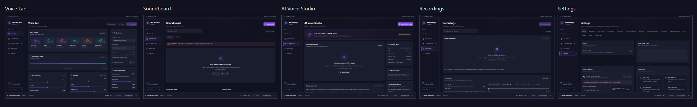

# Redesign screenshot gallery

These are actual rendered captures. `before/` contains the original browser UI at 1440×900. `after/` contains the production browser UI at the same viewport, full-page alternatives, DPR captures and measurements. `native/` contains Windows Tauri screenshots with the actual desktop bridge; its libraries were empty and the engine was idle.

| Workspace       | Before                                                         | Final production browser               | Native Tauri                            |
| --------------- | -------------------------------------------------------------- | -------------------------------------- | --------------------------------------- |
| Voice Lab       | [Dashboard baseline](before/voice-lab.png)                     | [Voice Lab](after/voice-lab.png)       | [Voice Lab](native/voice-lab.png)       |
| Soundboard      | [Soundboard](before/soundboard.png)                            | [Soundboard](after/soundboard.png)     | [Soundboard](native/soundboard.png)     |
| AI Voice Studio | [AI Voice](before/ai-studio.png)                               | [AI Voice Studio](after/ai-studio.png) | [AI Voice Studio](native/ai-studio.png) |
| Recordings      | [Original Dashboard recording controls](before/recordings.png) | [Recordings](after/recordings.png)     | [Recordings](native/recordings.png)     |
| Settings        | [Settings](before/settings.png)                                | [Settings](after/settings.png)         | [Settings](native/settings.png)         |

The old application had no separate recordings page. Its comparison baseline is deliberately the Dashboard, not a fabricated historical page.

[Implementation and validation report](../../UI_REDESIGN_REPORT.md) · [Design system](../../UI_REDESIGN_DESIGN_SYSTEM.md)
